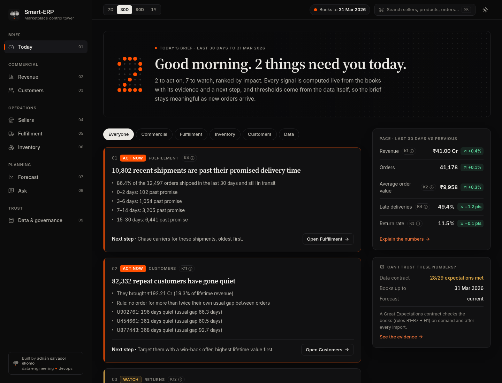
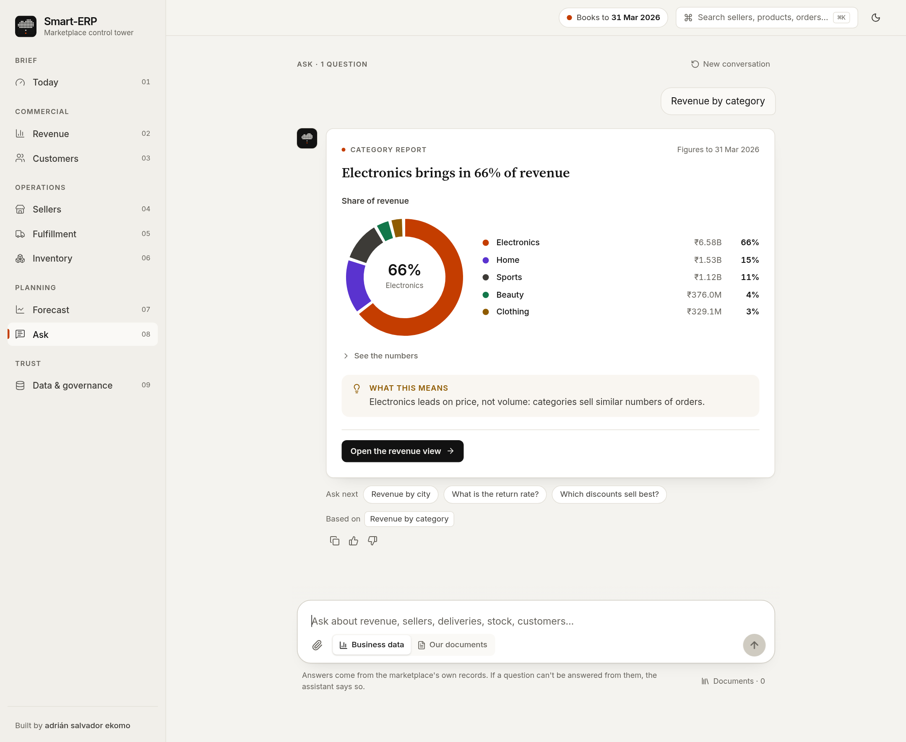
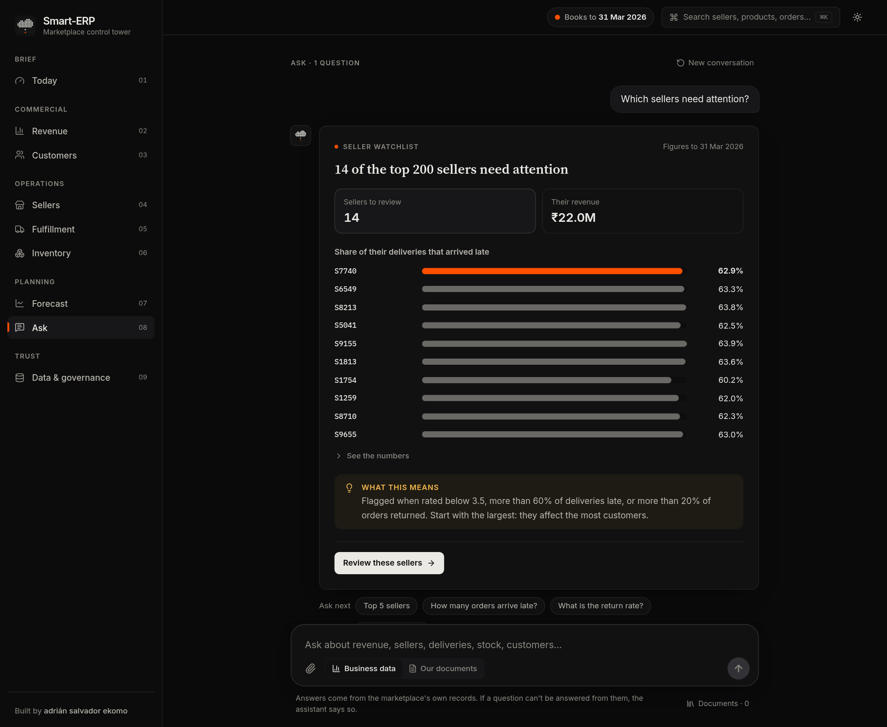
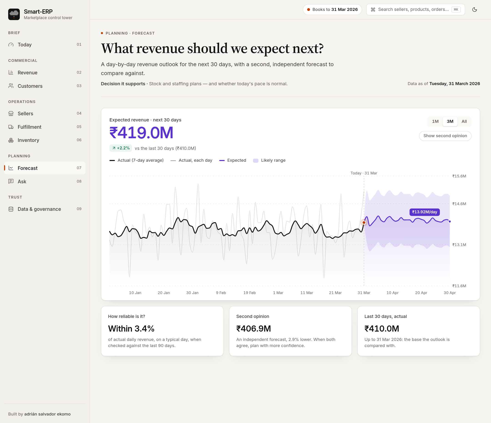
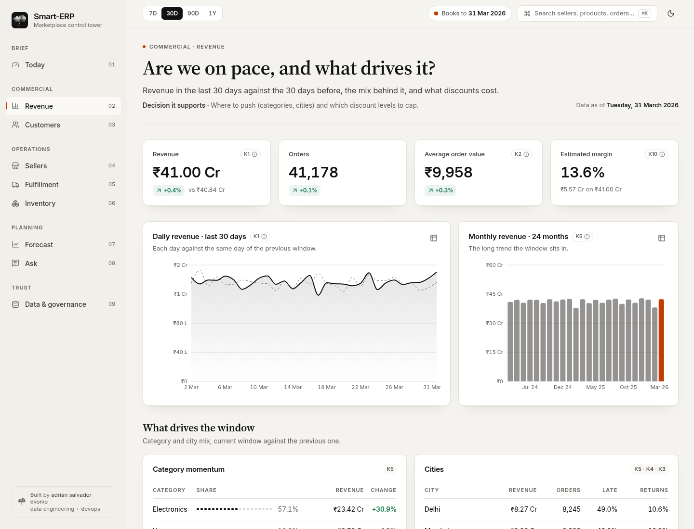

<h1 align="center">DataOps Lakehouse for E-commerce Analytics</h1>

<p align="center">
  <b>A marketplace control tower</b>: a ranked morning brief of what changed, why, and what to do —<br>
  computed live from PostgreSQL, guarded by Great Expectations data contracts, backed by a Databricks medallion lakehouse.<br>
  1M orders of a multi-seller marketplace (India, INR ₹).
</p>

<p align="center">
  
  
  
  
  
  
  
  <a href="https://github.com/adriansalvadorekomo/DataOps-Lakehouse-for-E-commerce-Analytics/actions/workflows/ci.yml"></a>
</p>

<p align="center">
  
</p>

---

## What it is for

A marketplace team does not need more dashboards; it needs to know **what to do today** and **whether the number telling it so can be trusted**.

| You are… | You ask… | The product answers with… |
|---|---|---|
| Marketplace operator | What needs me today? | A ranked brief: each signal with its evidence, a next step and a link |
| Commercial lead | Are we on pace? What do discounts cost? | Revenue vs the previous window, category momentum, estimated margin by discount band |
| Seller manager | Who hurts delivery or returns? | Seller flags against peers, only when statistically significant |
| Fulfillment / inventory | What is stuck? What runs out first? | Shipments past their promise; a reorder list ranked by days of cover |
| CRM / data science | Who is drifting away? | Customers quiet for more than twice their own usual gap, by lifetime value |
| Anyone | A question in plain words | A Claude-style chat that answers like an assistant's briefing — a short report with the key figures, a chart chosen for the question and where to act; every answer can be rated 👍/👎, and ratings are kept to improve it |
| Data owner | Can I report on this? | Automatic data checks (Great Expectations) on every import and on all the records |

**When new data arrives**, drop a marketplace export (CSV) on the *Data & governance* page: every row is checked (Great Expectations), new rows are added, rows already loaded are skipped, refused rows come back with a plain reason, all records are checked again, and every figure and alert moves forward on the next load. If the newest days look incomplete, the brief says *partial data* instead of reporting a collapse. → [docs/product.md](docs/product.md)

## Ask, and get a briefing

Ask a question in plain words and the answer comes back the way an executive assistant would brief you: a short report with the finding, the key figures, **a chart chosen for the question**, what it means, a button to the page where you act on it, and the natural next questions. Every answer can be rated 👍 / 👎; ratings are stored as a preference dataset to improve the answers later.

<p align="center">
  
  
</p>

## Every page answers one question

<p align="center">
  
</p>

<p align="center">
  
  
</p>

## How it works

<p align="center">
  <a href="docs/diagrams/c4/c4-container-light.svg">
    <picture>
      <source media="(prefers-color-scheme: dark)" srcset="docs/diagrams/c4/c4-container-dark@2x.png">
      
    </picture>
  </a>
  <br><sub>C4 Level 2 — click for the full-resolution SVG · <a href="docs/diagrams/c4/c4-context-light.png">Level 1: system context</a> · <a href="docs/architecture.md">architecture</a></sub>
</p>

- **PostgreSQL owns every write** and serves the live brief (cached on a data version, so any write invalidates it).
- **Great Expectations** gates every imported row (46 expectations) and validates the books in place (29), using the same rule IDs as the lakehouse gate.
- **Databricks owns analytics** and never writes back: Bronze (append-only) → Silver → **fail-fast DQ gate R1–R9** → Gold, one Workflows job.
- **Every change goes through a PR**: 10 CI jobs without secrets; a `v*` tag deploys the job, runs it and validates Gold.

## Results

Measured on the full dataset (1,000,000 synthetic orders, 24 months):

| | |
|---|---|
| Lakehouse DQ gate (R1–R9) | **0 violations**; Gold revenue **₹9,938,876,985**, reconciled within ±₹1,000 |
| Books contract (Great Expectations) | **28/29** expectations met; the 1 warning is real — ≈ 281,000 orders never closed "in transit" (H1) |
| Import, end to end on the 1M books | 505-row export: 300 added, 200 recognised as known, 5 rejected with their rule — validated in 0.8 s |
| The brief | ~8 s cold, ~150 ms warm at 1M orders |
| Forecast | Random Forest, 3.4% MAPE (rolling one-day-ahead, 90 days); Prophet 4.0% as second opinion |
| Tests | 59 API · 4 CD · 27 lakehouse (no cluster) · 6 web; 10 CI jobs on every PR |

**What the data says** (analyst notes in [business-model.md §7](docs/business-model.md#7-what-the-data-says-analyst-notes)): revenue is flat at ₹379–428M a month (an earlier "30× growth" claim compared a one-day month with a full one); category and brand turn out to be recorded per sale, not per product (89,933 of 89,999 product ids appear under several categories), so every breakdown uses the category *as sold*; 39% of order lines carry 30–50% discounts and, under the 65% cost assumption, sell below cost past 35% off; repeat customers (45%) bring 67% of revenue; and no recorded attribute predicts returns — so the project ships a hotspot test, not a model with nothing to learn.

## Quick start

Needs Python 3.12 + [uv](https://docs.astral.sh/uv/), Node 22 and [mise](https://mise.jdx.dev/). No Docker or system PostgreSQL: `mise run dev` boots an embedded one.

```bash
git clone https://github.com/adriansalvadorekomo/DataOps-Lakehouse-for-E-commerce-Analytics.git
cd DataOps-Lakehouse-for-E-commerce-Analytics
uv sync && npm ci --prefix frontend

mise run dev          # PostgreSQL → API :8000 (/docs) → Control Tower :5173
mise run seed         # load the 1M-row CSV (git-ignored) + acceptance checks
mise run governance   # Great Expectations run of the books contract
mise run forecast     # publish the 30-day outlook
```

The lakehouse logic runs without a cluster: `python -m unittest discover -s lakehouse/tests` and `python lakehouse/local_run.py`. Databricks tasks need `DATABRICKS_HOST` + `DATABRICKS_TOKEN` in `.env` ([operations](docs/operations.md)).

## Documentation

| Read | For |
|---|---|
| [Business model](docs/business-model.md) | The contract: data, lifecycle, money flow, KPIs K1–K12, rules — and what the data actually says |
| [Product](docs/product.md) | Who uses the Control Tower, the signals and their rules, what happens when data arrives, governance |
| [Architecture](docs/architecture.md) | C4 diagrams, the two planes, data governance, the medallion |
| [Decisions](docs/decisions.md) | Eleven ADRs, each with when to revisit it |
| [Roadmap](docs/roadmap.md) | Done / now / next / later, each with a measure |
| [Operations](docs/operations.md) | Setup, tasks, tests, CI/CD, Databricks, troubleshooting |

## Repository map

| Path | What lives there |
|---|---|
| [`frontend/`](frontend/) | The Control Tower: React 19, Vite, Tailwind v4, Radix, GSAP |
| [`backend/`](backend/) | FastAPI: brief (`services/insights.py`), KPIs, entities, imports, governance (`governance/`), orders, AI |
| [`database/`](database/) | PostgreSQL DDL: 11 migrations, invariants |
| [`lakehouse/`](lakehouse/) | Bronze / Silver / Gold, DQ rules R1–R9, notebooks, Gold SQL, the Workflows job, cluster-free tests |
| [`scripts/`](scripts/) | Seed + acceptance, CD scripts, dev helpers |
| [`infra/`](infra/) | Terraform (schemas, volumes, job), Docker Compose |
| [`bi/`](bi/), [`ml/`](ml/), [`notebooks/`](notebooks/) | AI/BI dashboard exports, forecasting, EDA |

## Limitations

What the project does not do yet, and how it lives with it today (details in [decisions.md](docs/decisions.md#known-limits) and [operations.md](docs/operations.md#databricks-free-edition)).

- **Synthetic data.** 1M orders over 24 months: the figures show the pipeline's discipline, not a business result.
- **Full refresh.** Silver and Gold rebuild from Bronze on every run (15–25 min at 1M rows). Fine at this size; past ~10M rows it needs an incremental `MERGE`.
- **A CSV seam between the planes.** Databricks Free Edition cannot reach a private PostgreSQL, so Bronze loads the same CSV from a Unity Catalog volume. The lakehouse is only as fresh as the last upload.
- **Two enforcement points.** The Great Expectations contracts and the Spark gate share rule IDs, but they are separate code that must stay aligned.
- **One small serverless cluster.** No autoscaling, no enterprise Lakeflow expectations; one serial job.
- **Estimated margin.** Costs are not in the source, so margin uses a 65% cost assumption and is labelled *estimated* everywhere.
- **One real data-quality warning stays open.** ≈ 281,000 orders are still "in transit" after 30+ days (H1); they are excluded from the late-delivery rate.
- **No return-propensity model.** No feature in the source predicts returns, so no model is served.
- **Single operator.** Local Terraform state, environment-variable secrets, no authentication or roles yet.

## What's next

From the [roadmap](docs/roadmap.md), each item with the measure that says it is done.

| Next move | Why | Done when |
|---|---|---|
| Re-run the lakehouse with categories as sold | Gold category figures match the books | `fact_sales` by category validates against the seed (Electronics 66%) |
| Close never-finished shipments (H1) | A late-delivery rate built on complete data | H1 cleared, or a documented rule closes statuses older than 30 days |
| Schedule the forecast refresh | The outlook never trails the books | Retrain after each import or nightly; no "forecast stale" signal in steady state |
| Incremental lakehouse (`MERGE`) | Scale past ~10M rows | Silver/Gold runtime grows with new rows, not total rows |
| Change-data capture into Bronze | Remove the CSV seam | Bronze lag under 15 minutes |
| Real cost of goods | Replace the 65% assumption | `products.unit_cost` populated; margin no longer *estimated* |
| Observability | See the system, not just the data | Latency, brief compute time and contract results as metrics with SLOs |

---

<p align="center">
  <a href="https://adriansalvadorekomodev.vercel.app"></a><br>
  <sub><a href="https://github.com/adriansalvadorekomo"><b>Adrián Salvador Ekomo</b></a> · data engineering + DevOps · <a href="https://www.linkedin.com/in/adriansalvadorekomo">LinkedIn</a> · <a href="https://adriansalvadorekomodev.vercel.app/blog/fail-fast-dq-gate-lakehouse">Write-up: put the quality gate between Silver and Gold</a></sub>
</p>
