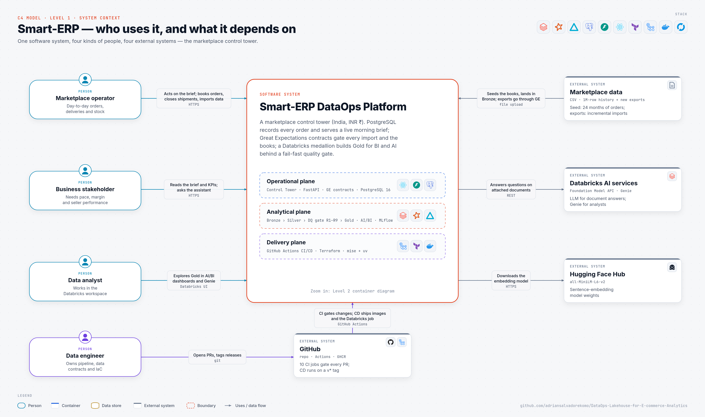
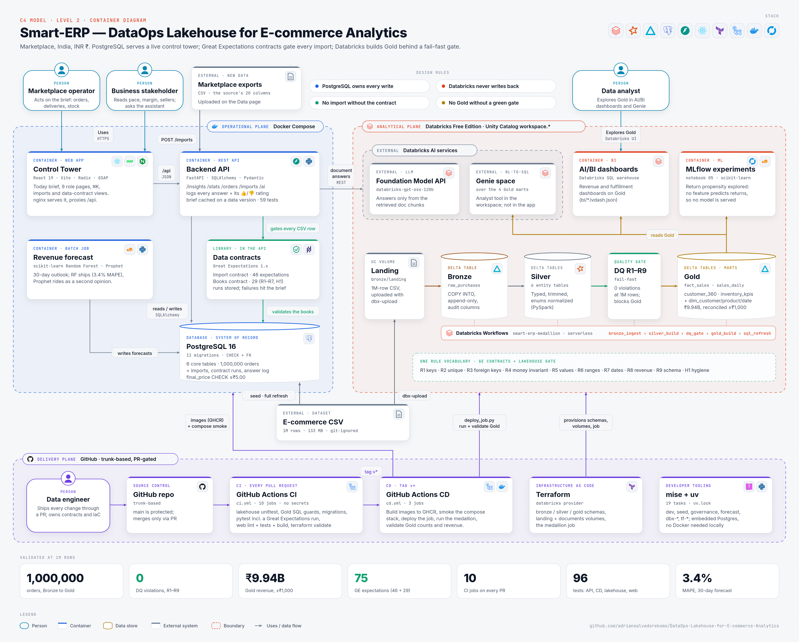

# Architecture

Two planes with one boundary. **PostgreSQL owns every write** and serves the live product; **Databricks owns analytics** and never writes back. A shared rule vocabulary (R1–R9, H1) is enforced at three points: the import gate, the books contract and the lakehouse gate. This page explains each part and why it is there; the reasoning behind each choice is in [decisions.md](decisions.md).

---

## C4 diagrams

The architecture is drawn with the [C4 model](https://c4model.com): **Level 1** shows the system, the people who use it and the external systems it depends on. **Level 2** opens the system into its containers, meaning the separately running or separately stored parts. Both come in a light and a dark version; GitHub picks the one that matches your theme.

### Level 1 — System context

<picture>
  <source media="(prefers-color-scheme: dark)" srcset="diagrams/c4/c4-context-dark.png">
  
</picture>

### Level 2 — Containers

<picture>
  <source media="(prefers-color-scheme: dark)" srcset="diagrams/c4/c4-container-dark.png">
  
</picture>

**How to read Level 2.** Cards with a coloured top bar are containers (the green one is a library inside the API), cylinders are data stores, grey cards are external systems, and dashed rounded boxes are boundaries (where a group of containers runs). The three planes:

| Plane | Runs on | Contains |
|---|---|---|
| Operational (blue) | Docker Compose, 3 containers (or `mise run dev` locally) | Control Tower → FastAPI → PostgreSQL; Great Expectations contracts inside the API gate imports and validate the books; the forecast job writes `revenue_forecasts` |
| Analytical (orange) | Databricks Free Edition, Unity Catalog `workspace.*` | Landing volume → Bronze → Silver → DQ gate → Gold, run as one Workflows job; Gold feeds AI/BI dashboards, Genie and MLflow |
| Delivery (violet) | GitHub | PR → CI (10 jobs) → `v*` tag → CD (images, compose smoke, deploy job + validate Gold); Terraform provisions the workspace assets |

**Data in.** The 1M-row CSV seeds PostgreSQL (`mise run seed`, 8 acceptance checks) and is uploaded to the landing volume (`mise run dbx-upload`), from which Bronze loads with `COPY INTO`. New marketplace exports enter through the API (`POST /imports`), gated row by row by the Great Expectations import contract. The designed production path is a JDBC snapshot from PostgreSQL into Bronze ([ADR-2](decisions.md)). Free Edition cannot reach a private database, so the diagram draws the path that actually runs.

**Regenerate.** The diagrams are code: `python docs/diagrams/c4/build_c4.py` rewrites the SVGs and renders 2× PNGs with headless Chromium (`--svg-only` skips the browser). Fonts (Inter, JetBrains Mono, OFL) and logos ([Simple Icons](https://simpleicons.org), CC0) are vendored in `docs/diagrams/c4/assets/`, so the build needs no network. If a number in the diagram changes in the code (tests, CI jobs, revenue), change it in `build_c4.py` and re-run.

---

## The boundary

| | Operational plane | Analytical plane |
|---|---|---|
| Runs on | Docker Compose (3 containers) or `mise run dev` | Databricks Free Edition, Unity Catalog `workspace.*` |
| Owns | Every write: orders, status transitions, stock, imports | History, cleaning, KPI marts, BI, ML experiments |
| Serves | The Control Tower (live, cached on a data version) | AI/BI dashboards, Genie, MLflow |
| Quality | Great Expectations: import contract + books contract | Spark DQ gate R1–R9, fail-fast before Gold |
| Never | Queries the lakehouse for CRUD | Writes to PostgreSQL |

The application's only read of Gold goes through Databricks Genie (`/ai/ask-genie`), read-only.

---

## Operational plane

**PostgreSQL 16 — the books.** Six core tables (customers, sellers, products, inventory, orders, order_items; see [business-model.md §2](business-model.md#2-the-data)) plus `audit_log`, `revenue_forecasts`, `documents`/`document_chunks`, `import_batches`/`import_rejections`, `governance_runs` and `ai_interactions` (answers + ratings). Eleven SQL migrations in `database/migrations/` (replayed by Alembic for the API). The database itself enforces the money invariant (CHECK, ±₹5.00), the lifecycle values, ranges and the foreign-key graph.

**FastAPI — the API** (`backend/app`).

| Area | Module | Notes |
|---|---|---|
| The brief | `services/insights.py` | Signal functions over a window anchored on the latest order date (`services/period.py`); data-derived thresholds; completeness guard |
| KPIs | `services/analytics.py`, `services/stats.py` | Raw SQL over indexed columns; heavy reads cached on `(count, max id, max updated_at)` so any write invalidates them; warm-up at start |
| Entities and search | `services/entities.py` | Seller / product / customer profiles, ⌘K prefix search |
| Orders | `services/orders.py` | One transaction per create or transition, stock lock, audit row |
| New data | `services/imports.py` | CSV → Great Expectations gate → idempotent append (`source_hash`) |
| Governance | `governance/` | Contracts as code, engine, stored runs, CLI |
| Forecast | `services/forecast.py`, `jobs/refresh_forecast.py` | Random Forest (served) + Prophet (second opinion) |
| Ask | `services/assistant.py`, `rag.py`, `api/assistant.py` | Business-language answers (deterministic intents); document answers via the Databricks FM API; every answer logged with its 👍/👎 rating |

**Web — the Control Tower** (`frontend/`): React 19, Vite, TanStack Query, Radix, GSAP; served by nginx, which proxies `/api` to the API. One page per role question; see [product.md](product.md).

---

## Data governance

Three enforcement points, one vocabulary:

| Rule | Meaning | Import contract (GE, per CSV row) | Books contract (GE, PostgreSQL) | Lakehouse gate (Spark, Silver → Gold) |
|---|---|---|---|---|
| R1 | Keys and required fields present, typed | ✓ | ✓ | ✓ |
| R2 | Business keys unique | — (dedup by fingerprint) | ✓ | ✓ |
| R3 | Foreign keys resolve | upserts parents first | ✓ (orphan query) | ✓ |
| R4 | `final_price` invariant ±₹5.00 | ✓ | ✓ | ✓ |
| R5 | Allowed values (status, category, payment, device) | ✓ | ✓ | ✓ |
| R6 | Ranges (discount 0–70, stock 0–500, ratings 0–5, days 1–6) | ✓ | ✓ | ✓ |
| R7 | Dates inside the business window | ✓ (not in the future) | ✓ | ✓ |
| R8 | Full-load revenue = ₹9,938,876,985 ± ₹1,000 | — | — | ✓ |
| R9 | Source schema complete | ✓ (missing columns fail the file) | — | ✓ |
| H1 | No order "in transit" > 30 days (warning) | — | ✓ | — |

Great Expectations suites are built from `backend/app/governance/contracts.py`; each expectation carries its rule, severity (`critical` / `warning`) and a plain-language reason. Books runs are stored in `governance_runs` and triggered on demand, after every import, by `mise run governance` (exit 1 on critical failure) and in CI.

---

## Analytical plane

```
UC volume (CSV) ─COPY INTO─► Bronze ──► Silver ──► DQ gate R1–R9 ──► Gold ──► AI/BI · Genie · MLflow
                              raw_purchases   6 entity      fail-fast       fact_sales · sales_daily
                              (append-only,   tables                        customer_360 · inventory_kpis
                               audit cols)                                  dim_customer/product/date
                 └──────────── Databricks Workflows: smart-erp-medallion (serverless) ────────────┘
```

| Layer | Tables | Contract |
|---|---|---|
| **Bronze** | `bronze.raw_purchases` | Source columns verbatim + `_ingest_ts`, `_source`; append-only; `COPY INTO` tracks files, so a re-run adds 0 rows. Designed production path: JDBC snapshot from PostgreSQL with a `purchase_date` watermark |
| **Silver** | six entity twins | Typed, trimmed, enums normalised; every business rule defined exactly once (e.g. `home_city`); order lines keep category, subcategory and brand as sold |
| **DQ gate** | — | R1–R9 (`lakehouse/src/quality/rules.py`); one violation fails the task, so Gold never builds on bad data and the last good Gold stays |
| **Gold** | `fact_sales` (one row per line, with the category / subcategory / brand **as sold**, `discount_band` and `estimated_line_margin`), `sales_daily`, `customer_360` (lifetime value, Pareto tier), `inventory_kpis` (stock-critical flag), `dim_customer`, `dim_product`, `dim_date` | Built from Silver only (CI `sql-parse` enforces it); revenue reconciled to the source |

The job (`lakehouse/workflows/smart_erp_job.json`) runs `bronze_ingest → silver_build → dq_gate → gold_build → sql_refresh`. Its logic is pure Python under `lakehouse/src/`, tested without a cluster, and `lakehouse/local_run.py` runs the same path on sample data.

**KPIs → where they live:** K1–K7 and K10 from `fact_sales`; K8 from `inventory_kpis`; K9 and K11 features from `customer_360`. The live product computes the same definitions on PostgreSQL ([product.md §8](product.md#8-api-map)).

---

## Delivery plane

GitHub, trunk-based: pull requests run 10 CI jobs without secrets; a `v*` tag runs CD (images → GHCR → compose smoke → deploy job → run → validate Gold). Terraform (`infra/terraform/`) provisions schemas, volumes and the job. Details: [operations.md §5–6](operations.md#5-branching-ci-and-cd).

---

## Constraints the architecture depends on

- **One writer.** Only PostgreSQL accepts writes; nothing writes back from the lakehouse.
- **Bronze is immutable.** Corrections are new rows downstream; Silver and Gold rebuild from Bronze.
- **No Gold without a green gate.** `gold_build` depends on `dq_gate` in the job graph.
- **No report without a contract.** Imports pass the import contract; the books contract runs after each import.
- **Windows follow the data.** Every "last N days" ends on the latest order date, so new data moves everything forward.
- **Estimated means estimated.** Margin uses a 65% cost assumption and is labelled as such everywhere.
- **No secrets in git.** `.env` locally, GitHub environment secrets in CD.
